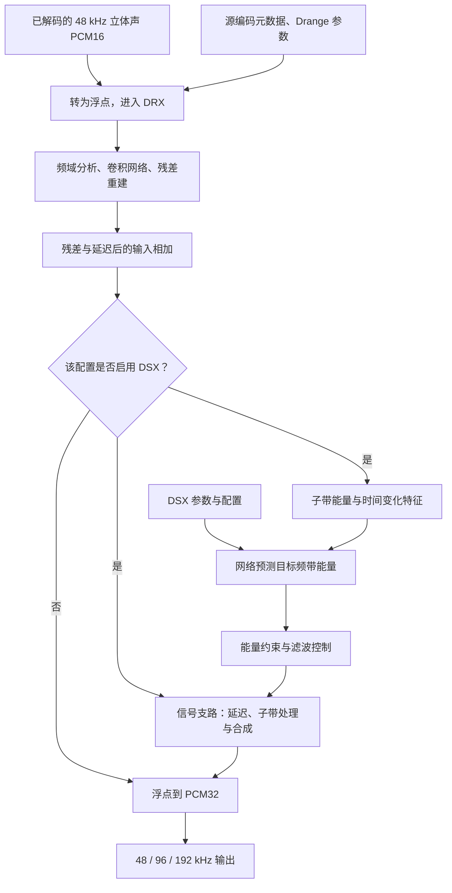

# Xperia 5 V `67.1.A.2.229`：DSEE 处理流程与原理

整理日期：2026-10-23。本文归纳本地研究和兼容验证，范围仅限
[`src/assets.hpp`](../src/assets.hpp) 按大小及 SHA-256 固定的资源组合。
内部机制的主要观察记录形成于 2026-10-21；后续跨平台结果见[验证记录](VALIDATION.md)。

这版实现将神经网络与传统音频 DSP 结合：**DRX 估计并补偿细节残差，DSX 预测频带能量，
再由滤波与频带合成路径生成补充信号。** DSX 的网络输出是少量频带控制量，
不能理解成网络直接生成完整的高采样率音频。

本文使用重新组织的文字、示意图和实验汇总解释行为。原库、参数、模型导出、反编译结果、
研究数据库和测试音乐均不随文档分发；本文也不提供独立重建原算法所需的完整规格。

## 1. 证据范围

以下几类依据不能互相替代：

| 标记 | 依据 | 能支持的结论 |
| --- | --- | --- |
| 公开资料 | Sony 本机型帮助文档 | 产品功能名称、公开描述和音效优先级 |
| 结构观察 | 外部研究中的静态数据流检查、参数结构检查 | 处理先后、算子类型、分支与资源的关系；存在分析误差的可能 |
| 本地实测 | 固定资源的调用、运行状态和控制变量实验 | 指定输入、配置和主机上的实际行为 |
| 原理解释 | 根据上述证据及通用 DSP 知识作出的归纳 | 帮助理解现象；不代表已知 Sony 的训练目标或设计意图 |

内部结构依据来自外部研究笔记 `REPORT.md`、`MECHANISM.md`；九种配置的状态记录为
`dsee-mechanism-state.jsonl`，分阶段和噪声实验记录为
`dsee-mechanism-experiments.json`、`dsee-noise-ablation.json`。
这里只列出记录名称以便本地核对，它们不属于本仓库的分发内容。
没有这些材料的读者无法仅凭默认 CTest 独立核验全部内部机制结论。

**现有参考不是 Xperia 真机播放输出。** 原包装函数、研究入口和兼容层的结果一致，
能验证这些调用方式的一致性，不能代替手机相同音频路由下的输出对照。

## 2. 为什么库名含 HX，而这里讨论 Ultimate

**公开资料：** Sony 将 Xperia 5 V 的相应功能称为 DSEE Ultimate，并描述为利用 AI
提升压缩音乐的质量；日文帮助页进一步提到高频与微细声音的再现。
见 [英文帮助](https://helpguide.sony.net/mobile/xperia-5m5/v1/en/contents/upscale_quality_compressed_music_file_dsee_ultimate.html)
和 [日文帮助](https://helpguide.sony.net/mobile/xperia-5m5/v1/ja/contents/upscale_quality_compressed_music_file_dsee_ultimate.html)。

**结构观察：** 这份固件中，音效设置的 Ultimate 开关经过音频服务、Audio HAL 和 PAL
到达 `SonyDseeHx` 包装层；内部继续使用 HX 命名。因此不能单凭
`libsonydseehxwrapper.so` 的文件名判断它是另一代产品算法。

手机实际启用情况还受路由、应用和其他音效影响。Sony 的
[本机型帮助](https://helpguide.sony.net/mobile/xperia-5m5/v1/en/contents/upscale_quality_compressed_music_file_dsee_ultimate.html)
明确说明 DSEE Ultimate 与 Dolby Sound 同时打开时，可能只有其中一个生效。
兼容运行时直接调用包装库，没有实现整套手机音频服务。

## 3. 从输入到输出

本项目已验证的工作输入为 **48 kHz、双声道、PCM16**；输出为 **48 / 96 / 192 kHz、
双声道 PCM32**。源编码类型及码率是另外提供的元数据，`aac128` 和 `mp3128`
不会让库解码 AAC 或 MP3。所选配置决定使用哪套 Drange 参数及哪些补偿分支。

下图归纳结构观察与分阶段测试。DSX 方框表示按配置启用的路径，具体分支见下一节。



两类参数由原库初始化代码读取，兼容层只负责校验并提供字节。
当前受支持路径可以在 CPU 上完成，Apple Silicon 执行原 ARM64 指令，Windows 使用
Dynarmic 执行同一库；测试路径没有要求额外的手机 NPU 推理运行时。
这不推导其他固件或设备上的执行方式。

### 外部模型与参数文件的体积

这版固件的相关模型与参数保存在以下外部文件中。表中是**整个文件的字节数**，
已与本地资源及 [`src/assets.hpp`](../src/assets.hpp) 的固定清单核对；
1 KiB = 1024 字节，1 MiB = 1,048,576 字节。

| 外部文件（资源根目录下的 `vendor/etc/`） | 用途 | 文件大小 | 换算大小 |
| --- | --- | ---: | ---: |
| `dsx_param_file.bin` | DSX 模型及相关配置 | 60,000 字节 | 58.594 KiB |
| `DrangeparaPCM48.bin` | PCM 配置的 DRX 参数 | 426,576 字节 | 416.578 KiB |
| `DrangeparaAAC128.bin` | AAC128 配置的 DRX 参数 | 426,576 字节 | 416.578 KiB |
| `DrangeparaMP3_128.bin` | MP3128 配置的 DRX 参数 | 426,576 字节 | 416.578 KiB |

一次处理只需 DSX 文件和所选源配置对应的一份 Drange 文件，合计 **486,576 字节，
约 475.172 KiB**；三套配置的全部四个文件共 **1,339,728 字节，约 1.278 MiB**。
三个 Drange 文件虽然等长，但内容哈希不同，不能互换。以上体积不包括算法库和运行内存。

**结构观察：** 外部 `dsx-model-architecture.json` 的解析记录中，9 个 DSX 模型记录
合计占 **53,491 字节，约 52.237 KiB**。这是带有结构与元信息的模型记录总长度，
不是纯权重字节数；也不能把整个 60,000 字节文件都计作权重。
Drange 文件的完整字段语义尚未全部厘清，因此这里不将其文件大小换算成神经网络参数量。
磁盘上的紧凑存储也不等于运行时内存占用：初始化后的数值表示、状态及音频缓冲还需要空间。

### DRX：在现有波形上估计残差

**结构观察：** 包装层先将 PCM16 转为浮点，再按 1024 输入帧调用 DRX。
已观察的卷积路径包含 2048 点 FFT、频带特征提取、卷积及密集连接、逆变换和重叠相加。
输出将预测残差加到延迟后的输入上。可以用下面的通用残差表达式理解：

`输出[n] = 输入[n − 延迟] + 估计残差[n]`

这只是概念表达式，不包含原实现的系数或运算细节。重叠相加用于衔接相邻处理窗；
1024 帧的调用粒度不等于全部内部算子的窗长，也不自动等于所有模式的总延迟。

PCM16 模式把补偿幅度限制在约半个 PCM16 量化步长的范围；AAC/MP3 使用各自的残差模式
和参数。**本地实测：** 一段 PCM 音乐在 48 kHz 输出时，只经过 DRX，测得对齐延迟
1024 帧，去掉边缘后的残差峰值为 0.5 PCM16 LSB，RMS 为约 −96.64 dBFS。
该数字描述这次测试，不是所有内容的固定噪声底。

**原理解释：** 量化把一个连续幅值区间映射成同一个整数，残差估计是在该区间内推测细节。
即使输出采用 PCM32，也不能据此声称恢复了真实的 32 位录音精度。
对有损压缩的补偿同样需要估计，无法保证唯一找回编码前的原始信号。

### DSX：从能量预测到频带合成

**结构观察：** 特征路径对每声道提取 8 个子带的功率，转到对数域，再组合当前能量、
一阶变化和二阶变化，形成 24 个特征。已观察的 48 kHz 工作路径以 128 输入帧的粒度
更新特征，约为 2.67 ms；这是内部特征更新节奏，不是公开 API 的块大小或总延迟。

这里的对数能量可用通用形式 `10 × log10(子带功率)` 理解，实际处理还设置能量下限并
进行标准化。时间差分让预测同时看到能量分布和它的变化，之后由小型卷积网络处理。

升采样高频扩展分支每声道产生 **3 个目标能量值**，之后还有回归、组合、能量约束与
时间对齐。合成路径结合目标能量与已测得的信号能量，控制滤波、增益和频带组合，
并执行所需的降采样、上转换及合成。原信号因此既提供分析特征，也参与输出信号的生成。

**原理解释：** 频带能量说明某一范围应有多少能量，并不唯一决定每个采样点的幅值和相位。
这能解释为什么网络规模较小，却可驱动高采样率输出；它也意味着不能把预测能量直接
当作已经找回的原始高频波形。合成路径还包含伪随机成分，其实际贡献需要实验判断。

本地结构研究观察到按初始化配置选择的多个模型变体，但没有证据将这些变体命名为
曲风或乐器分类器。训练集、损失函数和训练方法仍未知。本文不分发完整网络拓扑、
逐层记录、权重、偏置、归一化数据或滤波系数。

## 4. 哪些配置实际启用哪些阶段

下表归纳九种配置的本地运行状态。为便于解释，将 DSX 两组路径称为“带内补偿”和
“升采样扩展”；这是依据条件和数据流作出的功能归纳，不是 Sony 的正式模块命名。

| 源元数据 | 输出采样率 | DRX | DSX 带内补偿 | DSX 升采样扩展 |
| --- | --- | --- | --- | --- |
| PCM | 48 kHz | PCM16 残差模式 | 关 | 关 |
| PCM | 96 / 192 kHz | PCM16 残差模式 | 关 | 开，每声道 3 个目标能量 |
| AAC128 | 48 kHz | AAC 对应模式 | 开，每声道 6 个输出量 | 关 |
| MP3128 | 48 kHz | MP3 对应模式 | 开，每声道 7 个输出量 | 关 |
| AAC128 | 96 / 192 kHz | AAC 对应模式 | 开，每声道 6 个输出量 | 开，每声道 3 个目标能量 |
| MP3128 | 96 / 192 kHz | MP3 对应模式 | 开，每声道 7 个输出量 | 开，每声道 3 个目标能量 |

因此，48 kHz 输出不代表整个算法旁路：PCM 仍经过 DRX，AAC/MP3 还会启用 DSX 的一组路径。
反过来，PCM 升采样时也会执行 DSX 网络。

本项目传入的格式和参数选择可从 [`backend_native.cpp`](../src/backend_native.cpp)、
[`emulation.cpp`](../src/emulation.cpp) 与 [`resources.cpp`](../src/resources.cpp) 核对。
这些兼容层文件本身不能证明所有内部 DSP 细节；表中的内部状态来自外部研究记录。

不要为了得到更多高频而把无损来源故意标为 AAC128。这样会改变分支和参数，
既不是源格式自动识别，也不能保证补偿更准确。

## 5. 高频接缝：实测能解释到哪里

2026-10-21 的控制实验使用同一段本地音乐的 60–80 秒，先降低 3 dB，再准备为
48 kHz PCM16。各组收到完全相同的输入字节，均未应用本仓库的可调后处理。
功率谱采用声道平均的 Welch 估计，统计稳定的中间部分；不同模式未逐样本对齐后再
截取同一内容，因此下表的组间频带能量比较是近似值。
数值是频带积分功率对应的 RMS dBFS，不是频谱单个点的 dBFS/Hz。

| 处理条件 | 20–22 kHz | 22–24 kHz | 24–30 kHz |
| --- | ---: | ---: | ---: |
| PCM，48 kHz 输出，仅 DRX | −52.35 | −75.05 | 超出输出带宽 |
| PCM，96 kHz 输出，DRX + DSX | −48.52 | −50.48 | −52.17 |
| 同一 PCM 改标 AAC128，96 kHz 输出，仅作诊断 | −45.31 | −46.30 | −47.61 |

这段材料的主要高频变化出现在 DSX 启用后。它支持把观察到的高频接缝定位到 DSX 相关
处理路径，但不能把表中数值推广成固定的 DSEE 频响或所有歌曲的提升幅度。

两个进一步的控制实验缩小了原因范围：

- **原始采样率元数据：** 保持工作 PCM 为 48 kHz，只在研究入口把原始采样率元数据从
  48000 改为 44100，本次 PCM / 96 kHz 输出逐样本相同。它没有测试 44.1 kHz 工作输入，
  也没有验证手机重采样器；公开 C API 仍只接受 48 kHz 输入。
- **噪声贡献：** 在临时研究实例中关闭合成噪声，24–30 kHz 输出差值的 RMS 约
  −102.01 dBFS，比该频带约 −52.17 dBFS 的音乐能量低约 50 dB。
  本次明显的平台不能主要归因于噪声发生器。此实验没有修改原资源文件，
  正式 API 也没有关闭该噪声的选项。

**原理解释：** 当原信号已明显滚降，而预测与合成的补充频带仍有较强能量，
两部分衔接处就可能在频谱上出现台阶或平台。频带能量控制的结构与这一现象相容，
但全部合成滤波器的交接频率及参数语义尚未标定。不能从图片直接判断可闻失真、
音质优劣或高频是否与母带一致。

## 6. 兼容层和可调后处理各做什么

**原固件库**执行上述 DRX / DSX 和原参数读取；**兼容层**负责资源身份校验、
加载、运行环境适配、输入拼块、错误处理及结束排空。

公开 API 每次向原包装函数提供 1024 输入帧，分别得到 1024、2048 或 4096 输出帧。
在 48 kHz 输入下，每块表示约 21.33 ms 的音频。不同调用分片由兼容层拼接，
不会让算法在每次用户调用时重新初始化。

[`runtime.cpp`](../src/runtime.cpp) 的结束策略是：补齐不足一块的输入，继续送零块，
直到连续四个输出块全零，最多额外送入 48 个零块。这是本项目的排空策略，
不是对手机原有流结束协议的描述。输出保留延迟、补齐和排空产生的帧，空输入则没有输出。

[`POSTPROCESS.md`](POSTPROCESS.md) 中的包络约束、分频混合和自动比例选择，是本仓库
独立编写的可选离线 DSP，默认关闭，发生在原 DSEE 输出之后。
它们可以调整最终频谱和原信号的混合比例，不能据此反推 Sony 原算法内部使用了同一策略。
`--mix auto` 的选择指标也不是真实母带高频或听感最优的证明。

## 7. 验证与尚未解决的问题

已有本地记录包括四类合成信号、三套源元数据、三种输出率，共 36 组原包装函数参考前缀
匹配，以及九组尾部/分片测试。后续 Windows 与 macOS 的输出存在极小的数值差异，
不能把“使用同一库”写成跨平台全量逐位相同。具体比较范围见[验证记录](VALIDATION.md)。

仍未确定的内容包括：

- 训练数据、训练目标、感知损失及全部模型选择条件。
- 每个滤波器与参数的完整语义，以及全部配置下的精确延迟和带宽。
- 真实 AAC/MP3 编解码损伤的恢复质量；现有合成信号加元数据测试不等于编码质量评估。
- Xperia 真机同路由输出的等价性，以及其他固件的结构和行为。

在本地自备受支持资源时，可使用现有入口验证兼容行为：

```sh
build/dsee-compat inspect --assets /path/to/resource-root
build/api_test /path/to/resource-root
python3 tests/integration.py --exe build/dsee-compat \
  --assets /path/to/resource-root \
  --reference-results /path/to/external/validation.json \
  --report build/integration.json
```

这些命令不会重新完成本节之前的模型结构或音乐消融实验。那些实验依赖外部研究工具和
材料；本文只引用历史记录，未将它们纳入默认测试。默认 CTest 不需要任何 Sony 资源。

## 8. 分析文档的风险边界

用自己的文字解释功能事实、通用原理和实验结果，通常比公开原代码、反编译结果或
模型参数更容易控制风险；**这是一项工程上的风险判断，不是零风险或合法性的保证。**

以中国大陆规则为例，《计算机软件保护条例》第六条区分软件表达与思想、处理过程、
操作方法等，第十七条规定了学习研究设计思想和原理的特定使用情形；但第三条也将
软件有关文档纳入定义，第十八条、第二十四条还涉及许可范围与技术措施。
因此“原理可以讨论”不能自动推导出“原软件、原文档、模型和破解方法都可以发布”。
见[最高人民法院知识产权法庭刊载的条例](https://ipc.court.gov.cn/zh-cn/news/view-407.html)。

美国法的 [17 USC §102(b)](https://uscode.house.gov/us/usc/119-118/t17/s102/)
同样区分受保护表达与思想、流程、方法；
[17 USC §1201(f)](https://www.law.cornell.edu/uscode/text/17/1201#f)
的互操作性例外则有合法取得使用权、目的、必要性及信息分享等条件，不能视为所有
逆向研究和公开披露的通行许可。适用司法辖区、资源来源和实际软件许可需要分别判断。

本仓库的具体边界是：保留重新撰写的说明、必要的接口事实和有限实验汇总；
原始资源、完整模型导出、地址表、反编译代码与研究数据库留在仓库之外。
不把原函数逐句改写成可重建实现的文档，也不提供固件获取或绕过保护的教程。
没有在本文中进行专利、商业秘密或合同义务的专项审查；MIT 不能替代第三方授权。
若计划公开发布或商业分发，应让熟悉适用地区的软件知识产权律师审查具体材料与来源。
完整政策见[分发边界与来源说明](DISTRIBUTION.md)。
